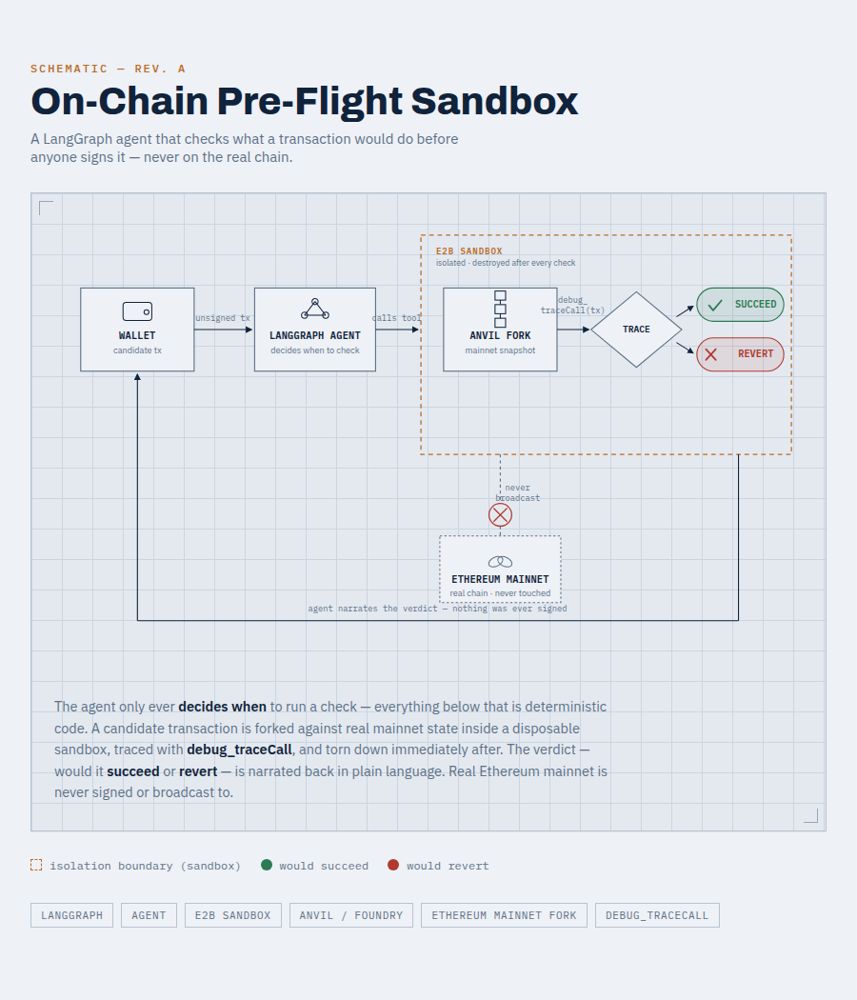

# On-Chain Pre-Flight Sandbox

A LangGraph agent that checks what an Ethereum transaction would **actually** do
*before* anyone signs it: it forks real mainnet state with **Anvil** inside an
isolated, disposable **E2B sandbox**, runs the transaction there with
`debug_traceCall`, and explains the verdict in plain language. Real Ethereum
mainnet is never signed or broadcast to.



> The on-chain part is the *pretext*; the real subject of this project is
> **sandboxed execution for agents**: building a versioned sandbox image, the
> open → execute → read → teardown lifecycle, and wiring a sandbox call into an
> agent as a tool with proper timeout, error and input handling.

## Why

- **Agents that run code need isolation.** Coding agents, data-analysis agents,
  and agents that "test-drive" an action before committing it all need a place
  to execute where nothing leaks into the host or persists afterwards.
- **A plain `eth_call` isn't enough.** It only says *succeed / revert*. A full
  execution trace needs `debug_traceCall`, which free public RPCs don't expose
  (`-32601 method not found`). Running our own Anvil fork gives the full debug
  namespace against real chain state.
- **Disposable by design.** A fresh sandbox is created for every check and
  killed right after — no state carries over between checks, nothing lingers if
  a call fails half-way.

## How it works

```
user: "I'm about to sign this tx (to, data, value) — what will it do?"
        │
        ▼
LangGraph ReAct agent ── decides WHEN to check ──► preflight_check_via_sandbox(to, data, value)
                                                            │   (host side, sandbox_tools.py)
                                                            ▼
                                   ┌──────────── E2B sandbox (custom template) ───────────┐
                                   │ 1. start Anvil: fork mainnet at latest / pinned block │
                                   │ 2. debug_traceCall(candidate tx, callTracer)          │
                                   │ 3. print ONE line of JSON: SUCCEED | REVERT | ERROR   │
                                   └───────────────────────────────────────────────────────┘
                                                            │  sandbox.kill() (always, in finally)
                                                            ▼
                         agent narrates the verdict — it never decides "risky" on its own
```

### Design decisions

- **The agent decides *when*, deterministic code decides *how*.** The LLM only
  chooses to call the tool and narrates its output; the simulation and the
  verdict are plain code. The system prompt forbids inventing outcomes that are
  not in the tool output.
- **Untrusted input never touches a shell.** Calldata is agent/attacker
  controlled, so it is passed into the sandbox via environment variables
  (`envs=`), never interpolated into the command string. The `to` address is
  validated and checksummed before a sandbox is even created.
- **A machine-readable contract between sandbox and host.** The in-sandbox
  script (`preflight_check.py`) prints a single JSON line; the host tool parses
  it and distinguishes a real **REVERT** from a simulation **ERROR** (bad input,
  RPC problem) instead of "reading" free text.
- **Build once, reuse a versioned image.** The sandbox image (Python 3.12 +
  Foundry + the check scripts) is defined in code with E2B's `Template()`
  builder and built once; every sandbox starts from that snapshot.
- **Bounded resources.** Sandbox lifetime 120 s, command timeout 90 s, 1 vCPU /
  1 GB RAM template.

## Project phases & files

| Phase | What | Files |
|---|---|---|
| 1 — local | Anvil fork + `debug_traceCall` on a SUCCEED case (WETH `deposit`) and a REVERT case (WETH `withdraw` with no balance), zero cloud cost | `anvil_fork.py`, `anvil_lifecycle.py` |
| 2 — sandbox | The same check inside a custom E2B template, full lifecycle via the SDK | `e2b_template.py`, `build_template.py`, `e2b_run.py` |
| 3 — agent | The sandbox call as a LangGraph tool the agent decides to use | `preflight_check.py` (runs inside the sandbox), `sandbox_tools.py`, `sandbox_agent.py` |

All three phases were verified end-to-end against live infrastructure (local
fork, real E2B sandboxes, real Claude calls), including tool-level tests of both
the SUCCEED and REVERT paths before the agent-level run.

## Quickstart

Requirements: Python ≥ 3.12, [uv](https://docs.astral.sh/uv/), a free
[E2B](https://e2b.dev) account (Hobby tier, no card), an Anthropic API key.
[Foundry](https://getfoundry.sh) is only needed to run Phase 1 locally.

```bash
uv sync
cp .env.example .env        # fill in E2B_API_KEY and ANTHROPIC_API_KEY

# Phase 1 (optional, local): needs Foundry/anvil installed
.venv/bin/python anvil_fork.py

# Phase 2: build the sandbox image once, then run the check inside a sandbox
.venv/bin/python build_template.py
.venv/bin/python e2b_run.py

# Phase 3: the agent — demo asks about a WETH.withdraw that would revert
.venv/bin/python sandbox_agent.py
```

`FORK_RPC_URL` defaults to a public mainnet endpoint; set `FORK_BLOCK_NUMBER` to
pin the fork for reproducible runs. Rebuild the template whenever a file copied
into the image changes — the image is a snapshot, not a live sync.

## Lessons learned (found while building)

- E2B's current template API is the Python `Template()` builder; the older
  Dockerfile + `e2b.toml` flow described in many tutorials has been superseded.
- Template build steps run as user `user`, not `root`, so Foundry lands in
  `/home/user/.foundry/bin`.
- An image-level `PATH` set with `.set_envs()` did not reliably reach a
  `subprocess.Popen` started via `commands.run()`; the fix resolves the `anvil`
  binary explicitly (`shutil.which()` → `~/.foundry/bin/anvil`), so the same
  script works locally and in the sandbox.
- A cached build step failed intermittently on the E2B side; builds always use
  `skip_cache=True` (about one minute either way).

## Safety

100% simulation. No private keys, no signing, no broadcasting — every
transaction runs against a throw-away fork inside a throw-away sandbox. Secrets
live in `.env` (git-ignored); see `.env.example`.

## Limitations

- Ethereum mainnet only, one transaction per check.
- Simulates from Anvil's pre-funded dev account by default (`TX_FROM` can
  override inside the sandbox), so balance-dependent results reflect that
  account, not the user's wallet.
- Uses `langgraph.prebuilt.create_react_agent`, which newer LangGraph versions
  mark as deprecated.

## Related

- [eth-preflight-sign-safety-agent](https://github.com/divamvak/eth-preflight-sign-safety-agent)
  — the earlier read-only version (calldata decoding + `eth_call`). This project
  exists because public RPCs don't support `debug_traceCall`.
